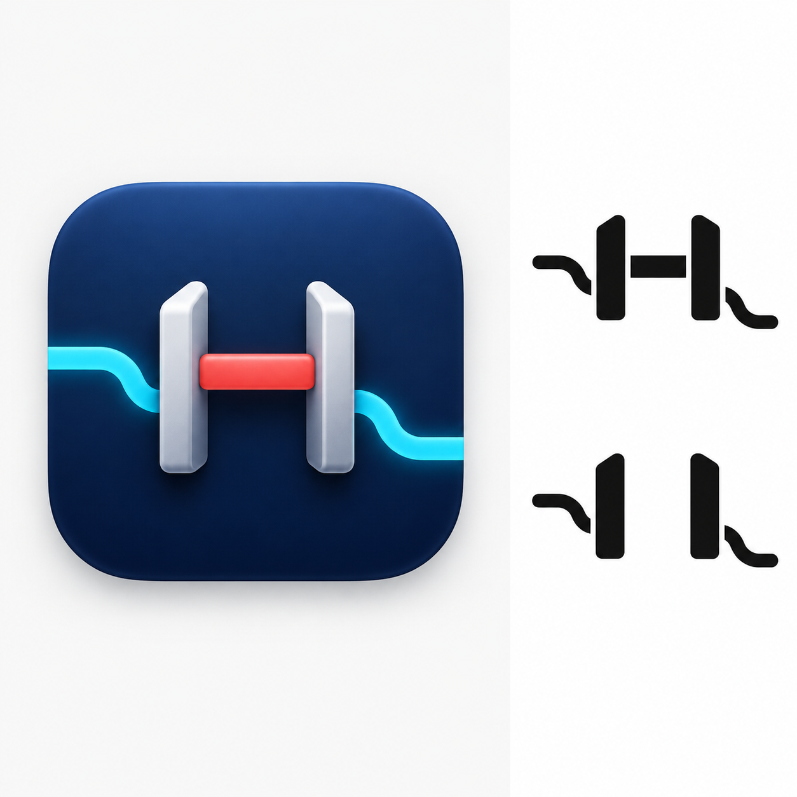
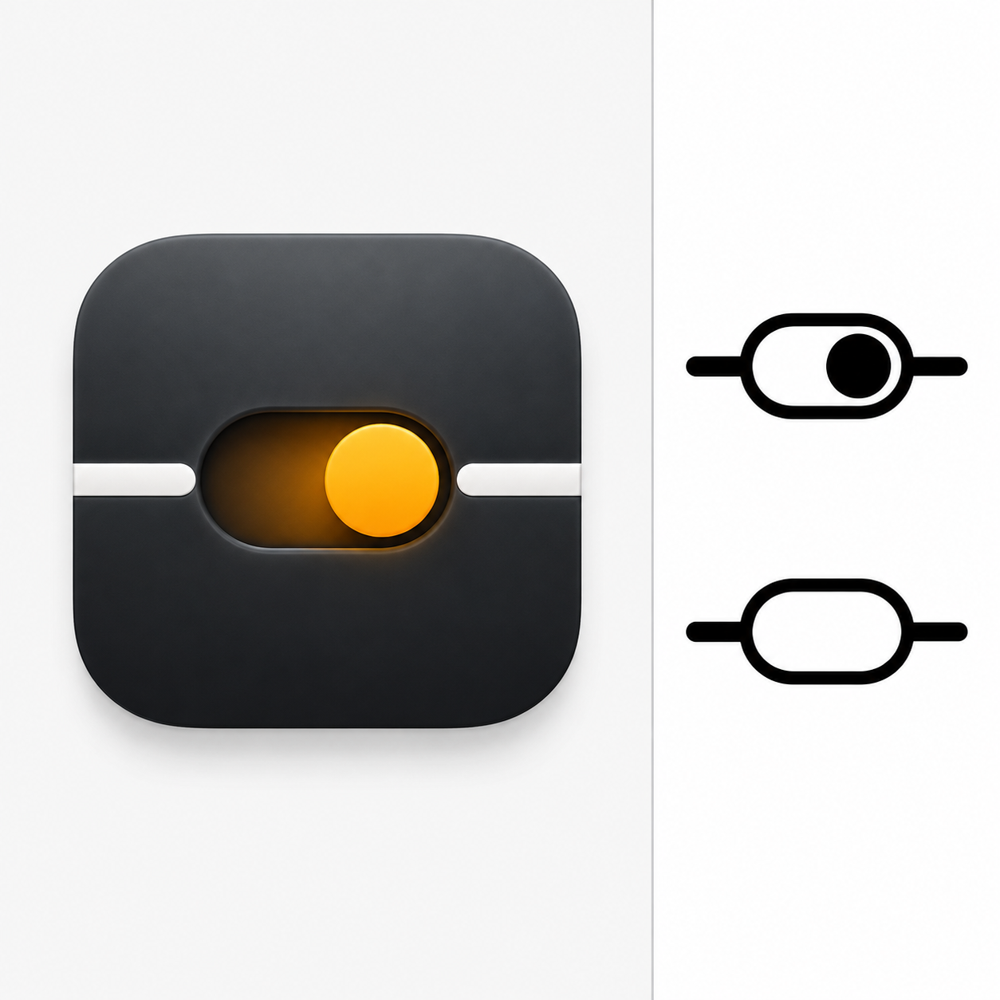
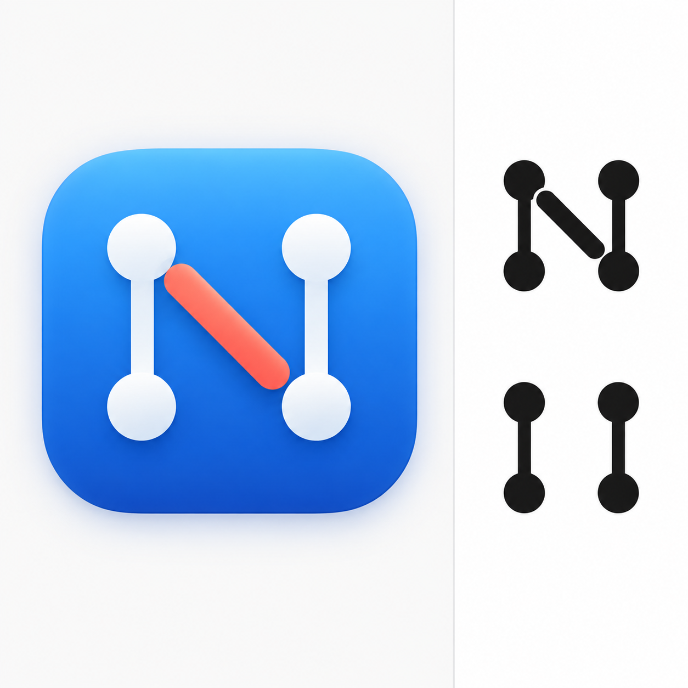
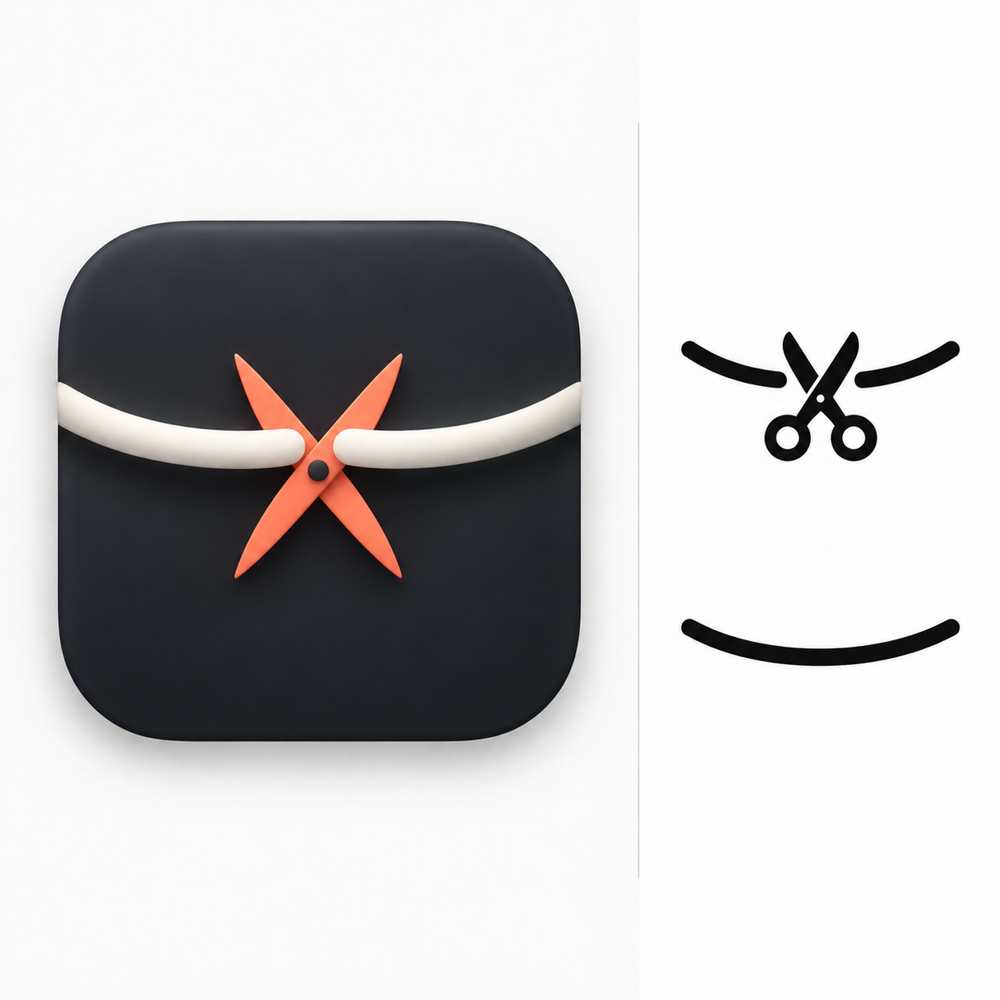
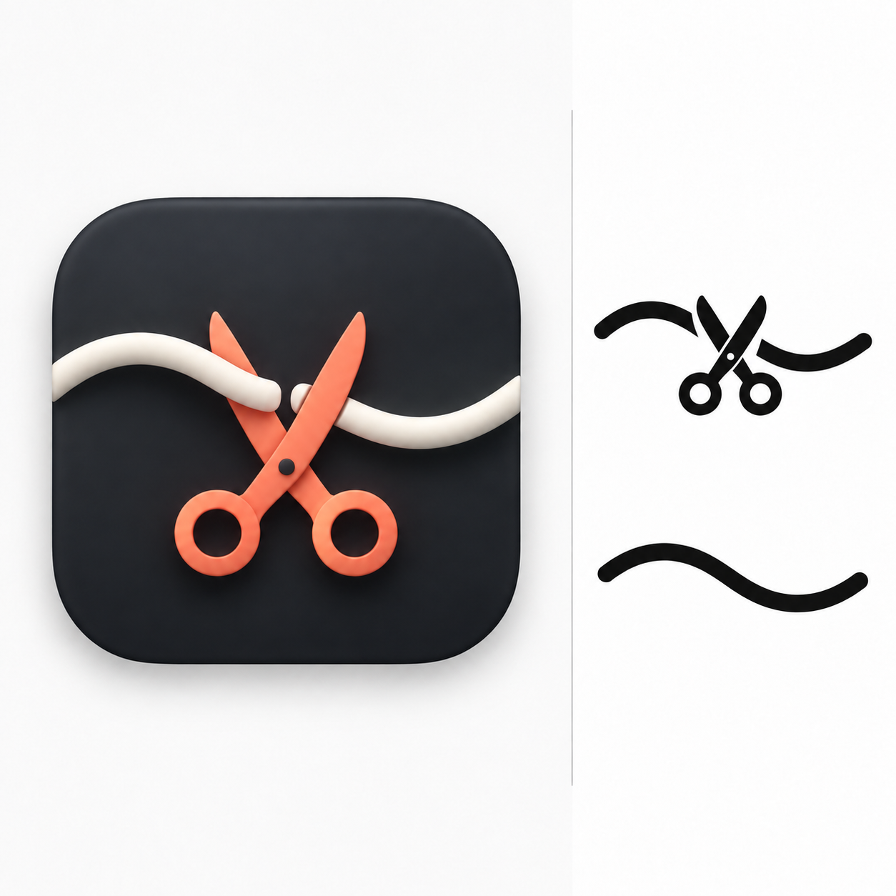

# NetBlock icon candidates

Generated with the built-in imagegen tool. These are comparison mockups, not production template images. Left: app icon. Right top: enabled. Right bottom: disabled.

## A — Gate

Prompt: Use case: logo-brand. Asset: macOS NetBlock icon design candidate Gate. Make a square comparison board on a pale neutral background. Left approximately 65%: one polished rounded-square macOS application icon, centered with generous space, subtle dimensional material, crisp at small sizes. A sculptural pair of upright gate posts with a horizontal coral stop bar interrupting a cyan network path, deep navy rounded square app tile. Theme: selective network gate. Avoid globe, shield, padlock. Right approximately 35%: matching macOS menu bar symbol as simple bold black silhouette on white, with two versions vertically arranged: enabled has a clear blocking stroke, disabled has the same underlying mark with that stroke absent. These monochrome marks must be readable at 18 pixels, few strokes, no tiny details. Show marks enlarged for review. No text, no labels, no watermarks, no other objects. Strong coherent visual identity between app icon and menu symbols.

## B — Switch

Prompt: Use case: logo-brand. Asset: macOS NetBlock icon design candidate Switch. Make a square comparison board on a pale neutral background. Left approximately 65%: one polished rounded-square macOS application icon, centered with generous space, subtle dimensional material, crisp at small sizes. A minimal elegant toggle switch with an amber slider interrupting a white network line, dark graphite rounded square app tile. Theme: deliberate on/off control. Avoid globe, shield, padlock. Right approximately 35%: matching macOS menu bar symbol as simple bold black silhouette on white, with two versions vertically arranged: enabled has a clear blocking stroke, disabled has the same underlying mark with that stroke absent. These monochrome marks must be readable at 18 pixels, few strokes, no tiny details. Show marks enlarged for review. No text, no labels, no watermarks, no other objects. Strong coherent visual identity between app icon and menu symbols.

## C — Domain

Prompt: Use case: logo-brand. Asset: macOS NetBlock icon design candidate Domain. Make a square comparison board on a pale neutral background. Left approximately 65%: one polished rounded-square macOS application icon, centered with generous space, subtle dimensional material, crisp at small sizes. A bold geometric letter N formed from connected network nodes, one connecting segment replaced by a coral diagonal stop mark, cool blue rounded square app tile. Theme: NetBlock network mark. Avoid globe, shield, padlock. Right approximately 35%: matching macOS menu bar symbol as simple bold black silhouette on white, with two versions vertically arranged: enabled has a clear blocking stroke, disabled has the same underlying mark with that stroke absent. These monochrome marks must be readable at 18 pixels, few strokes, no tiny details. Show marks enlarged for review. No text, no labels, no watermarks, no other objects. Strong coherent visual identity between app icon and menu symbols.

## D — Wire cut

Built-in imagegen. Left: abstract scissor cut application icon. Right top: blocking on, wire cut by scissors. Right bottom: blocking off, continuous curved wire. Concept preview only.

Initial prompt: Use case: logo-brand. Create one polished NetBlock macOS icon design comparison board, square canvas, pale neutral background. Left 65%: a rounded-square midnight graphite macOS app icon with a refined abstract mark for scissors cutting a wire. A single luminous curved wire is separated by a clean small gap, and two simple diagonal blade forms meeting at a tiny pivot suggest a scissor cut; understated warm coral blades and cool ivory wire, minimal geometric composition, restrained shallow 3D highlights. Do not draw a detailed household scissors illustration; abstract the cutting action into a memorable bold symbol. Right 35%: two large pure black monochrome menu bar icon mockups on white, vertically stacked. Top represents blocking ON: a gently curved horizontal wire interrupted in the middle, with unmistakable simple scissors cutting at the gap (two small circular handles and crossing blades), ends separated slightly. Bottom represents blocking OFF: ONLY one continuous gently curved horizontal wire, no scissors, no other elements. Same wire curvature and proportions in both states. Design the monochrome shapes for clarity at actual 18px size: bold strokes, minimal detail, compact scissors. App icon and menu bar marks should feel related. No lettering, labels, switches, plugs, globes, shields, locks, watermarks. Generous margins and clean separation between left and right.

Refinement prompt: Edit only the application icon on the LEFT of this NetBlock comparison board. Keep the entire RIGHT panel and its two black menu bar marks unchanged. Left app icon: replace the literal coral scissors with an abstract cutting symbol: no circular finger holes or recognizable full scissors. Use only TWO SHORT elegant tapered coral diagonal blades crossing at a small dark pivot, centered directly at the gap in the curved ivory wire, compact and geometric like a sharp abstract X cut. Preserve the curved ivory wire with its central gap, the dark graphite rounded-square tile, existing lighting, scale and layout. Make it refined and abstract with very few shapes, clear at small sizes. No text or other additions.

## E — Tilde wire and scissors

Built-in imagegen edit of the original full-scissors concept. The wire follows a tilde curve. In the app icon, the left wire is in front of one blade and the right wire behind the other. Right top: blocking on; right bottom: blocking off.

Prompt: Edit this NetBlock icon comparison board. Preserve the original full scissors concept: left is the graphite rounded-square macOS app tile with CORAL SCISSORS INCLUDING TWO ROUND HANDLES and ivory wire; right contains two monochrome menu bar marks. Requested changes only: 1) In ALL THREE marks, reshape the wire into an asymmetric smooth horizontal S-wave, like the tilde character ~: one hump on the left and one trough on the right, flowing organically across the mark. It must NOT be a symmetric smile/U curve. 2) In the LEFT APP ICON, make the scissor cutting action spatially convincing: the left ivory wire segment passes IN FRONT of one scissor blade, while the right ivory wire segment passes BEHIND the other blade near the central cut. Clear overlapping occlusion at the blades, subtly different shadows, two short separated wire ends at the cutting point. Keep realistic simple full scissors with coral finger rings, dark pivot and refined shallow 3D finish. 3) RIGHT TOP blocking ON menu symbol: the same tilde-shaped wire cut at the center by simple black scissors with round handles. RIGHT BOTTOM blocking OFF: only the same continuous tilde-shaped black wire, no scissors or cut. Preserve panel layout, colors, scale, plain neutral background, polished simplicity. No text or labels. Keep bold simple shapes suitable for 18px menu bar use.

## Adopted production icon

Built-in imagegen extraction/edit prompt: Extract and finish ONLY the LEFT application icon from this comparison board as a standalone square macOS app icon asset. Preserve exactly the graphite rounded-square tile, coral full scissors with circular handles and pivot, ivory tilde-shaped wire cut at the center with left segment in front of blade and right segment behind blade, the existing composition, materials and lighting. Remove comparison board, white background, divider and ALL right-hand menu bar symbols. Center the rounded-square tile, filling roughly 84% of the square canvas with consistent transparent padding around it, including corners; actual alpha transparency outside tile. No new elements, no text. Do not redesign the icon.

Production source: `../../NetBlock/Assets/NetBlock-icon.png`. Menu symbols are drawn as template images in NetBlockApp.swift.
